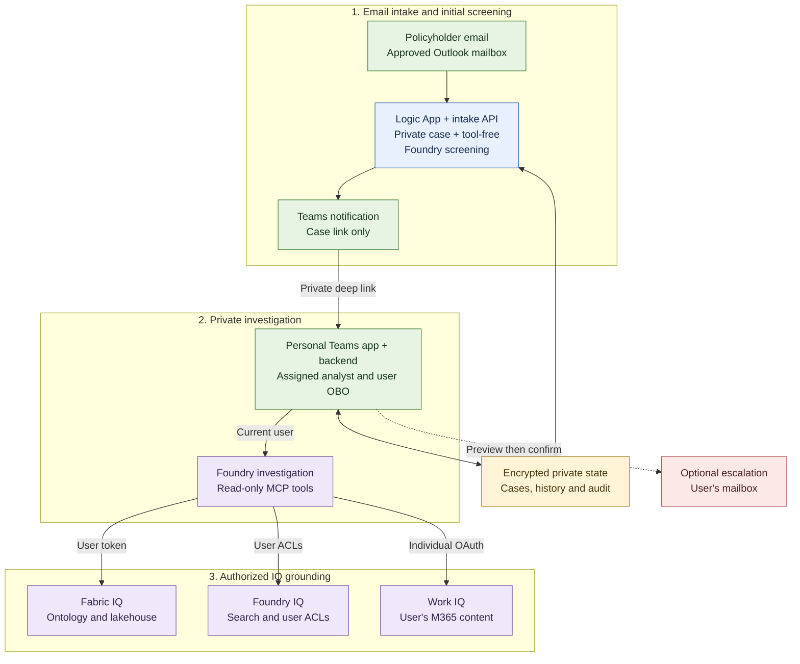
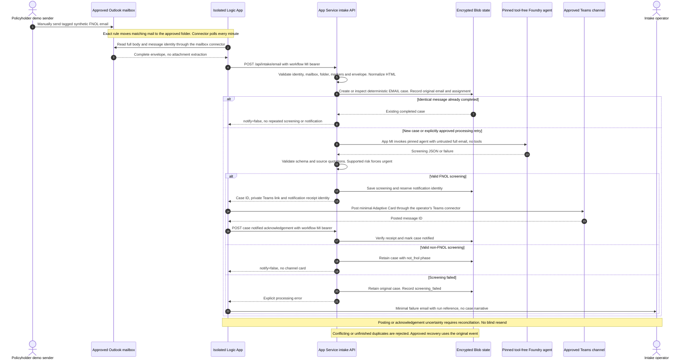
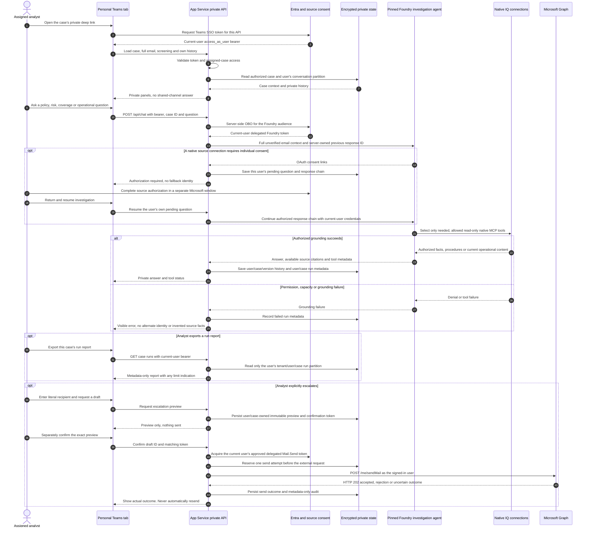

# FNOL v2: user-delegated insurance investigation

An isolated Microsoft IQ pilot: approved mailbox intake, private investigation
inside Microsoft Teams, native Fabric IQ Gen 2 ontology grounding, ACL-aware
Foundry IQ and individual Work IQ authorization.

This revision contains **v2 only**. V1 code, automated tests, diagnostic scripts,
synthetic HTTP probes and historical reports are not part of the published tree.
Fresh deployments require neither the v1 repository nor any v1 cloud resources.

## Solution versions

| Version | GitHub branch |
|---|---|
| V1: original solution and documentation | [main](https://github.com/sagarbathe/Ins_FNOL_MicrosoftIQ_Logicapps_accelerator/tree/main) |
| V2: this standalone, user-delegated solution | [sagarbathe-microsoft-delegated-agent-authentication](https://github.com/sagarbathe/Ins_FNOL_MicrosoftIQ_Logicapps_accelerator/tree/sagarbathe-microsoft-delegated-agent-authentication) |

V2 is published separately; `main` remains the original v1 tree. Removing v1
files from the v2 branch does not delete them from `main` or Git history.
Switch to `main` to browse or deploy v1. Neither branch switch nor source
publication changes existing Azure, Fabric or Microsoft 365 deployments.

## Core contents

| Path | Purpose |
|---|---|
| `v2/` | Application, identity boundaries, deployment modules and infrastructure |
| `v2/templates/`, `v2/static/` | Private Teams interface |
| `v2/generate_data.py` | Synthetic insurance data generation |
| `v2/data.py`, `v2/ontology_definition.py`, `v2/ontology.py` | Lakehouse loading and verified Gen 2 ontology creation |
| `v2/knowledge_docs/`, `v2/knowledge.py` | Illustrative source documents and native knowledge ACL setup |
| `v2/notifications.py`, `v2/email_deploy.py`, `v2/email_enable.py` | Approved private Teams destination and mailbox workflow lifecycle |
| `v2/infra.bicep`, `v2/network.bicep` | Isolated Azure foundation and private state networking |
| `requirements.txt` | Deployment dependencies, including the runtime requirements |
| `docs/` | Deployment and end-to-end demo instructions |

No Fabric notebooks or Data Factory pipelines are deployed. Python generates
Parquet files and the Lakehouse Load Table API loads the nine tables. Most
runtime components are Azure resources, not Fabric workspace items.

## Runtime architecture

V2 separates **autonomous email screening** from **human-authorized IQ
investigation**. The Logic App coordinates connector and HTTP actions; it does
not use the native preview Logic Apps Agent action. The human investigation
agent chooses its allowed native MCP tools inside Foundry. There is no v1
OpenAPI proxy, Teams reply poller or Fabric SQL `CaseThreadMap` dependency.

### Architecture at a glance

Read top to bottom: an email becomes a private case, an assigned analyst opens
it in Teams, and the investigation agent retrieves only authorized IQ data.
Solid arrows show the main flow. The dotted arrow is an optional,
human-confirmed escalation.



The processing and investigation stages share **one App Service backend**.
Intake uses managed identities; investigation uses the analyst's delegated
access. The full token exchanges, failure handling, reporting and send
confirmation are in the workflows below. Key Vault,
private networking and provisioning are covered in the [deployment guide](docs/deployment.md).

### Trust boundaries

| Boundary | Enforcement |
|---|---|
| Mailbox connector | Reads only the approved intake source. Its identity never becomes the human investigator. |
| Workflow managed identity (MI) | May call only its configured intake/notification APIs after tenant, audience and application-identity validation. It is not a human bearer token. |
| Application MI | Infrastructure access to Key Vault, encrypted state, tool-free screening and narrowly scoped operator recovery. No fallback for human IQ authorization. |
| Human API | Validates Teams token signature, issuer, audience, tenant, scope and client; checks case assignment. No cookie/shared-account fallback after Teams authentication failure. |
| IQ tools | Fabric uses `UserEntraToken`; Foundry IQ uses `ProjectManagedIdentity` service transport with native user ACL enforcement; Work IQ uses individual `OAuth2` authorization. |
| Private state | Conversations are keyed by tenant, user, case and agent version; run reports and escalation previews are user/case-owned. Audit records omit prompts, answers and provider response IDs. |

Only Blob application state is depicted as private-endpoint-only. App Service,
Foundry, Search and Key Vault have their separately documented network controls;
this diagram does not imply the whole solution is private-only.

### Email-to-case workflow



The screening is an **illustrative, unverified narrative assessment**, not a
coverage decision or a stored fraud finding. Policy-only notices are valid;
claim IDs are not invented. New screening versions do not automatically rewrite
previously completed cases. Failure alerts contain only operational metadata.

### Private investigation, reporting and confirmed escalation



Fabric answers structured questions over the ontology; Foundry IQ retrieves
governed illustrative procedures; Work IQ retrieves user-accessible current
operational information. A service transport identity is **not** permission to
return documents the human cannot access. Individual consent does not broaden
source ACLs. Graph HTTP 202 means send acceptance, not confirmed delivery.

### Implementation map

| Diagram component | Repo implementation |
|---|---|
| Mailbox isolation, polling and minimal notifications | `v2/mail_source.py`, `v2/email_deploy.py`, `v2/email_enable.py`, `v2/notifications.py` |
| Original email, duplicate handling and quoted screening evidence | `v2/email_processing.py` |
| Teams UI, bearer validation, OBO and case ownership | `v2/teams.py`, `v2/static/app.js`, `v2/app.py`, `v2/auth.py` |
| Pinned human agent and native IQ connections | `v2/agents.py`, `v2/runtime.py`, `v2/knowledge.py`, `v2/workiq.py` |
| Synthetic tables and Gen 2 ontology provisioning | `v2/generate_data.py`, `v2/data.py`, `v2/ontology_definition.py`, `v2/ontology.py` |
| Private state, network boundary, explicit send and recovery | `v2/state.py`, `v2/network.bicep`, `v2/escalation.py`, `v2/recovery.py` |

## Deployment and demonstration

Copilot is **not required**. The deployment entry point is:

```powershell
python -m v2.deploy --help
```

- [Deployment guide](docs/deployment.md): prerequisites, configuration, commands,
  administrator steps and readiness checks.
- [Demo runbook](docs/demo.md): one approved synthetic email through private Teams
  investigation, report export and optional confirmed escalation.

Run stages sequentially from the repository root. Deployment state is saved in
`.secrets\v2\deployment.json`; never commit it or use another environment's state.
The deployment refuses unowned resources and retains protections for existing
workflows listed in that private state. New initialization records
`protectedWorkflows: []`; no existing workflows are required. Optionally record
actual fingerprints of workflows that must remain unchanged. Existing pilot
`emailIntake.protectedV1Workflows` entries remain enforced for compatibility,
even when the new list is empty; they are not required for a fresh deployment.

For a separate deployment, use a clean source folder, a new resource prefix and
fresh initialization. Do not copy `.secrets` or adopt the running pilot's resource
IDs. See the deployment guide's clean-copy instructions. Local standalone checks
do not establish fresh-tenant Outlook-to-Teams acceptance.

## Local-only material

The maintainer's local checkout separates non-core material as follows.
These paths are Git-ignored and are **not included in a fresh GitHub clone**:

| Path | Contents |
|---|---|
| `temp\legacy-v1\` | Preserved v1 implementation and original documentation |
| `temp\tests\v2\` | Automated regression tests |
| `temp\diagnostics\` | Diagnostic scripts, synthetic probes and local evidence |
| `temp\acceptance\` | Historical capability acceptance tracker |
| `temp\design-history\` | Detailed design and investigation history |
| `.secrets\v2\` | Active private deployment configuration and generated assets |

Moving source files does not remove or reconfigure deployed Azure, Fabric or
Microsoft 365 resources. Historical versions remain in Git history.

## Pilot boundaries

- Synthetic data and explicitly approved mailbox routing only.
- No automatic claim creation, attachment OCR, Fabric write-back or recurring
  data-engineering pipeline.
- Do not broaden source permissions to make a user's question succeed.
- Restricted-user ontology initialization and Agent 365 onboarding remain parked;
  overall deployment readiness must not be inferred from owner-path acceptance.
- Ontology, delegation and integration APIs include preview components. This is
  an evaluation accelerator, not a production-readiness claim.
